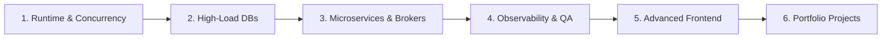

<div align="center">

# 🚀 Go Learning: Fullstack to Middle Go Developer

[](https://go.dev/)
[](https://react.dev/)
[](https://www.typescriptlang.org/)
[](https://www.postgresql.org/)
[](https://redis.io/)
[](https://kafka.apache.org/)
[](https://www.docker.com/)

**Практический путь трансформации Fullstack-разработчика (React + TypeScript) в сильного Middle Backend-инженера на Go.**

*Фокус на глубоком понимании рантайма, concurrency-паттернах, распределенных транзакциях, оптимизации PostgreSQL, микросервисах и low-latency архитектуре.*

[🧭 Дорожная карта (Roadmap)](ROADMAP.md) • [✅ Чеклист проверки (Verification)](VERIFICATION.md) • [🎯 Целевые проекты](#-боевые-пет-проекты)

</div>

---

## 📌 О репозитории

Этот репозиторий содержит материалы, конспекты, бенчмарки и исходный код пет-проектов для целенаправленного перехода на уровень **Middle Go Backend Developer**.

В отличие от типовых обучающих туториалов уровня "Hello World" или простых CRUD-приложений, фокус сделан на:
- **Низкоуровневых механиках Go:** Escape Analysis, внутренности сборщика мусора (Tricolor Mark & Sweep), планировщик GMP, управление памятью и профилирование (`pprof`).
- **Сложной работе с хранилищами:** Блокировки в PostgreSQL (`SELECT FOR UPDATE`), уровни изоляции, предотвращение Deadlock'ов, тюнинг `pgxpool`, структуры данных Redis (SkipList в ZSET) и Redlock.
- **Распределенных паттернах:** Transactional Outbox, Consumer Groups в Kafka, идемпотентная обработка событий, gRPC Streaming и Interceptors.
- **Высоких нагрузках и Real-Time:** Конкурентные WebSocket-серверы, авторитарный игровой цикл (Game Loop) с тикрейтом 60 FPS, нагрузочные тесты k6 и мониторинг в Prometheus/Grafana.

---

## 📑 Навигация по документации

| Документ | Описание |
| :--- | :--- |
| 🧭 **[ROADMAP.md](ROADMAP.md)** | **Полная дорожная карта (6 этапов):** рантайм Go, базы данных под нагрузкой, микросервисы и очереди, Observability & CI/CD, React 19 Frontend и ТЗ двух боевых проектов. |
| ✅ **[VERIFICATION.md](VERIFICATION.md)** | **Критерии готовности и чеклист:** глубокие вопросы для самопроверки и собеседований уровня Middle, чеклист архитектурных фич и критерии приемки портфолио. |

---

## 🛠️ Архитектурный стек

```
                                  [ Client Layer ]
                          React 19 + TypeScript + Pixi.js
                                         │
                    ┌────────────────────┴────────────────────┐
             HTTP / REST                              WebSocket / Protobuf
                    │                                         │
                    ▼                                         ▼
         ┌─────────────────────────────────────────────────────────┐
         │                  Go Backend Services                    │
         │       Chi/Gin • gRPC Services • Authoritative Loop      │
         └─────────────┬───────────────────────────┬───────────────┘
                       │                           │
          Transactional Outbox             Distributed Lock & Cache
                       │                           │
                       ▼                           ▼
            ┌──────────────────────┐    ┌──────────────────────┐
            │     Apache Kafka     │    │   Redis (ZSET/Locks) │
            └──────────────────────┘    └──────────────────────┘
                       │
                       ▼
            ┌──────────────────────┐
            │  PostgreSQL (pgx)    │
            └──────────────────────┘
```

| Область | Технологии & Инструменты | Применение |
| :--- | :--- | :--- |
| **Backend & Runtime** | Go 1.23+, `net/http`, Chi / Gin, `sync`, `atomic` | Ядро сервисов, параллельная обработка, Worker Pools |
| **RPC & Сеть** | **gRPC**, **Protocol Buffers v3**, WebSockets | Межсервисный транспорт с бинарной сериализацией, live-стриминг данных |
| **Базы данных** | **PostgreSQL 16**, `pgx/v5`, **Redis 7** | Персистентность, блокировки, кэш, distributed lock, лидерборды (ZSET) |
| **Message Broker** | **Apache Kafka** / **RabbitMQ** | Асинхронный обмен событиями, паттерн Transactional Outbox |
| **Observability** | **Prometheus**, **Grafana**, `log/slog` | Метрики RED, дашборды latency p95/p99, структурированные логи |
| **Тестирование** | `go test`, **Testcontainers-go**, **k6** | Изолированные интеграционные тесты в Docker, stress/load тестирование |
| **Frontend** | **React 19**, **TypeScript**, TanStack Query, Zustand, Canvas API / Pixi.js | High-load интерфейсы, Seat Map, интерполяция движения 60 FPS |

---

## 🗺️ Краткий обзор этапов Roadmap



1. **[Этап 1: Внутренности Go и Concurrency](ROADMAP.md#этап-1-внутренности-go-и-продвинутая-конкурентность-23-недели)**
   * Escape Analysis, Memory Alignment, `iface`/`eface`, GC (Tricolor Mark-Sweep, STW), планировщик GMP.
   * `sync.Pool`, Fan-In/Fan-Out, Worker Pool, Rate Limiter, Graceful Shutdown.

2. **[Этап 2: Базы данных на уровне Middle](ROADMAP.md#этап-2-базы-данных-на-уровне-middle-2-недели)**
   * PostgreSQL: `SELECT FOR UPDATE`, версионирование, уровни изоляции, `EXPLAIN (ANALYZE, BUFFERS)`, тюнинг `pgxpool`.
   * Redis: SkipList в ZSET, стратегии кэширования, Distributed Locks (Redlock).

3. **[Этап 3: Микросервисы, gRPC и брокеры](ROADMAP.md#этап-3-микросервисы-grpc-и-брокеры-сообщений-3-недели)**
   * Protobuf v3, Unary & Streaming gRPC, Interceptors.
   * Apache Kafka: Consumer Groups, гарантии доставки, Transactional Outbox, идемпотентные консьюмеры.

4. **[Этап 4: Observability, Тестирование и CI/CD](ROADMAP.md#этап-4-observability-тестирование-и-cicd-2-недели)**
   * Метрики Prometheus (RED-метод), дашборды Grafana, структурированное логирование `log/slog`.
   * Testcontainers-go, нагрузочные сценарии k6, GitHub Actions CI с `-race` и `golangci-lint`.

5. **[Этап 5: Frontend (React 19 + TypeScript)](ROADMAP.md#этап-5-frontend-react-19--typescript-для-сложных-интерфейсов-2-недели)**
   * Дискриминантные объединения, TanStack Query, Zustand, WebSocket-клиент с Exponential Backoff, Pixi.js/Canvas.

6. **[Этап 6: Боевые пет-проекты](ROADMAP.md#этап-6-боевые-пет-проекты-middle-portfolio)**
   * Полноценная реализация двух комплексных проектов для портфолио.

---

## 🏆 Боевые пет-проекты

### 🎟️ 1. High-Load Booking & Auction Engine
> **Финтех / E-Commerce сервис мгновенного бронирования билетов и проведения live-аукционов.**

- **Ключевые вызовы:**
  - Защита от Race Condition и овербукинга: временный 10-минутный холд места через Redis Distributed Lock и финальная транзакция в Postgres.
  - Live-аукцион со ставками в реальном времени через WebSockets с минимальным latency.
  - Гарантированная доставка событий через **Transactional Outbox** в Apache Kafka.
  - Нагрузочный стресс-тест в k6 (симуляция сотен параллельных покупок на одно место).

### 🎮 2. Real-Time Multiplayer Game Server
> **Многопользовательская 2D-арена с сессионным матчмейкингом и авторитетным сервером.**

- **Ключевые вызовы:**
  - **Authoritative Server:** Вся физика, расчет коллизий и попаданий производятся исключительно на Go-бэкенде.
  - Изолированный Game Loop на горутинах с фиксированным тикрейтом (60 FPS).
  - Оптимизированный бинарный протокол: **Protocol Buffers** поверх WebSockets.
  - Матчмейкинг игроков по MMR/ELO и мгновенный глобальный лидерборд через **Redis Sorted Sets (ZSET)**.
  - Клиентская интерполяция движения (Lerp) на React + Canvas / Pixi.js.

---

## 📂 Структура репозитория

```text
GoLearning/
├── README.md               # Главная страница и обзор проекта
├── ROADMAP.md              # Подробная 6-этапная программа развития
├── VERIFICATION.md         # Чеклист теории и критериев готовности проектов
│
├── docs/                   # Архитектурные заметки, схемы, конспекты
│   ├── runtime/            # Конспекты: память, GMP, GC
│   └── database/           # Оптимизация SQL, блокировки, транзакции
│
├── theory/                 # Код-примеры и микробенчмарки
│   ├── 01-memory-gc/       # Примеры Escape Analysis, padding структур
│   ├── 02-concurrency/     # Worker Pools, Pipelines, Context, sync.Pool
│   └── 03-postgres-pgx/    # Блокировки, pgxpool, транзакции
│
└── projects/               # Исходный код ключевых пет-проектов
    ├── booking-auction/    # High-Load Booking & Auction Engine
    └── multiplayer-game/   # Real-Time Multiplayer Game Server
```

---

## ⚡ Быстрый старт для разработки

### Требования к окружению
- **Go:** `1.23+`
- **Node.js:** `20+` / **pnpm**
- **Docker & Docker Compose**
- **k6** (для нагрузочного тестирования)

### Полезные команды

```bash
# Проверка конкурентности и гонок данных (Data Race Detector)
go test -race ./...

# Анализ утечек в кучу (Escape Analysis)
go build -gcflags="-m -m" ./...

# Запуск линтера
golangci-lint run

# Запуск окружения инфраструктуры (PostgreSQL, Redis, Kafka)
docker compose up -d
```

---

<div align="center">

⭐ **Цель поставлена — только вперед!**  
*Создано для системного перехода в Middle Go Backend Engineering.*

</div>